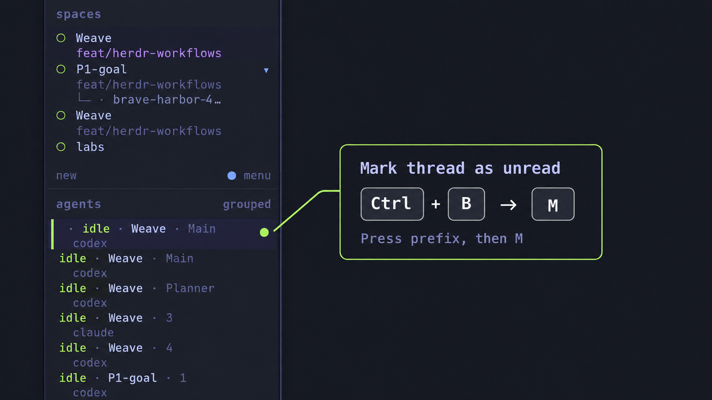

# Herdr Marks as Unread



Keep track of agents you want to revisit. Add a red `*` to the start of an
agent's sidebar detail line, then have it clear automatically when
you return to that terminal.

The marker is display-only metadata. It does not change the agent's lifecycle
status, completion badge, name, title, or notifications.

## Install

Requirements: Herdr 0.9.3+, Node.js 18+, and Python 3.11+. Supports macOS and Linux;
live verification has been performed on macOS.

Run these commands from a shell inside Herdr:

```sh
herdr plugin install sachin-philip/herdr-marks-as-unread
herdr plugin action invoke local.herdr-marks.setup
```

Setup backs up changed configuration, adds the red marker token to the start
of your existing second sidebar row, binds `prefix+m`, and reloads the config.
It refuses to overwrite another command already using that shortcut. Check setup
logs with:

```sh
herdr plugin log list --plugin local.herdr-marks
```

The stable plugin ID is `local.herdr-marks` to remain compatible with the initial
local installation. If you already linked that version, unlink it before using
`plugin install` to switch to GitHub-managed updates:

```sh
herdr plugin unlink local.herdr-marks
```

## Use

1. Focus the agent you want to mark.
2. Press **Control+B**, release, then **M** (or your configured prefix, then M).
3. Switch away. When you return to the agent's terminal, its marker clears.

Repeat the shortcut to remove a marker manually. On macOS this uses Control,
not Command, and does not require Option. Multiple agents can be marked.
There is no custom sidebar right-click handler.

## Behavior and limitations

- Marking the terminal you are already viewing keeps the marker until you leave
  and return. Pane, tab, and workspace focus events trigger clearing.
- This is a personal unread marker, not a change to Herdr's `done`/`idle` state.
- Marks are pane metadata, shared by clients attached to the same server.
  Returning from another client can also clear a mark.
- Marks disappear on pane closure or server restart. A replacement agent in the
  same pane inherits the mark until it is cleared.
- Expanded sidebar rows are required. Status filters can still hide marked agents.
  Custom `rows_by_agent` layouts must also include the `$herdr_mark` token.
- Herdr always joins the marker to the next token with ` · `, so a marked agent
  reads `* · idle · claude`. The separator is hard-coded in Herdr's
  sidebar renderer and no layout setting removes it.
- The marker cannot replace the state word. Herdr's token rules only see their
  own token's value, so `state_text` cannot hide itself when a mark is set.
- The plugin records the latest focus result and last verified clear under its
  Herdr-provided state directory, in `last-focus.json` and `last-cleared.json`.

## Manual configuration

Add the styled token before the first token of your existing second agent row,
or of the only row in a single-line layout. For example:

```toml
[ui.sidebar.agents]
rows = [
  ["state_icon", "machine", "workspace", "tab"],
  [{ token = "$herdr_mark", fg = "#f7768e", bold = true, dim = false }, "state_text", "agent"],
]

[[keys.command]]
key = "prefix+m"
type = "plugin_action"
command = "local.herdr-marks.toggle"
description = "Toggle agent marker"
```

Merge these entries with existing sections instead of duplicating them, then run
`herdr server reload-config`. Choose a different shortcut if `prefix+m` is occupied.

## Local development

```sh
git clone https://github.com/sachin-philip/herdr-marks-as-unread.git
cd herdr-marks-as-unread
python3 install.py
node --test marks.test.mjs
python3 -m unittest discover -p 'test_*.py'
```

`install.py` links the checkout and configures the sidebar. For a GitHub-managed
installation, the setup action uses `--configure-only` so it retains its managed
registration and update support. Do not move a linked checkout while using it.

From the source directory, you can toggle a specific live agent pane directly:

```sh
node marks.mjs toggle w1:p1
```

Replace `w1:p1` with an actual pane ID from `herdr agent list`.

## Update and uninstall

```sh
herdr plugin update local.herdr-marks
herdr plugin uninstall local.herdr-marks
```

Before uninstalling, clear any markers. After uninstalling, remove `$herdr_mark`
from your sidebar layouts and remove this plugin's `[[keys.command]]` entry, then
reload the config. For a local checkout, use `herdr plugin unlink` instead.

## License

MIT. See [LICENSE](LICENSE).
